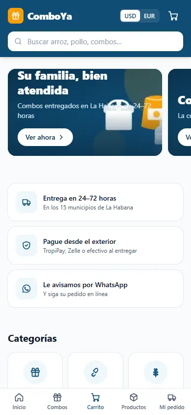
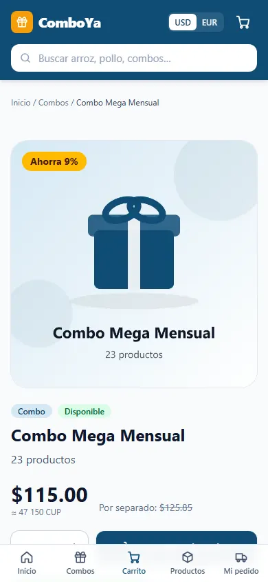
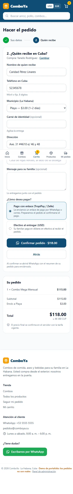
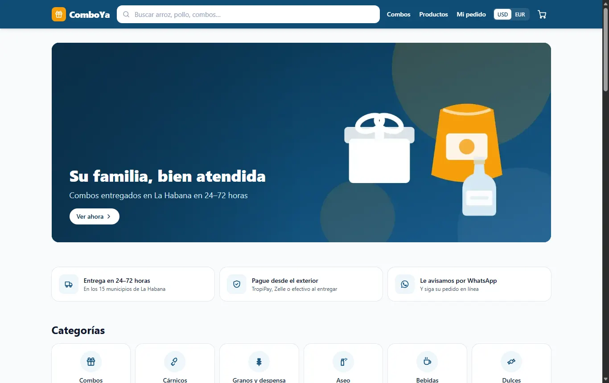
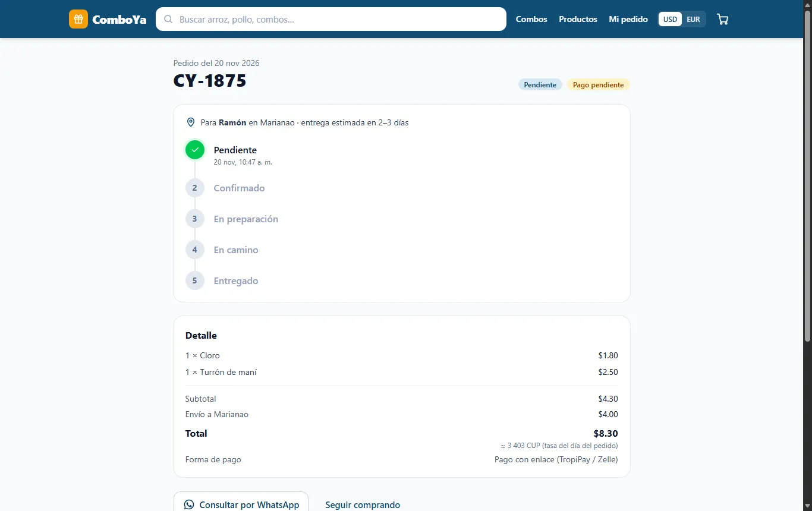
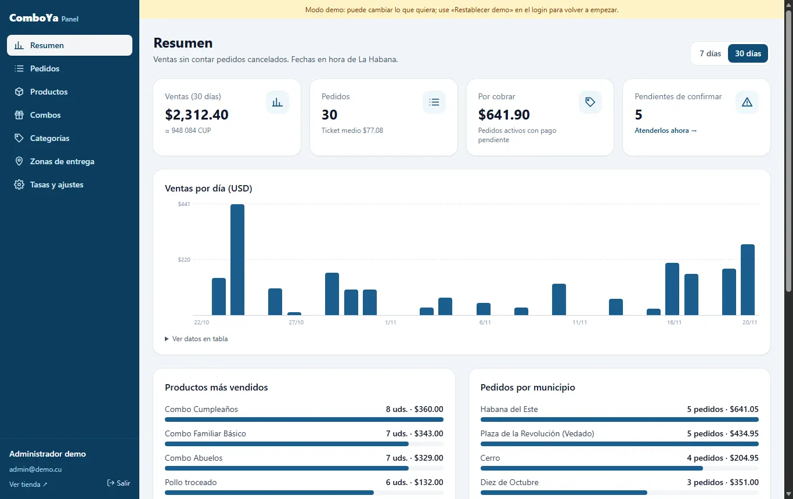
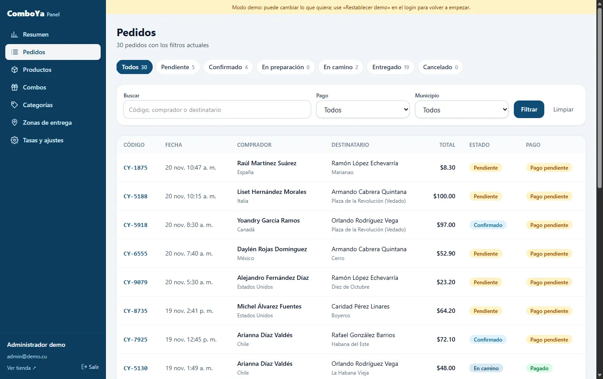
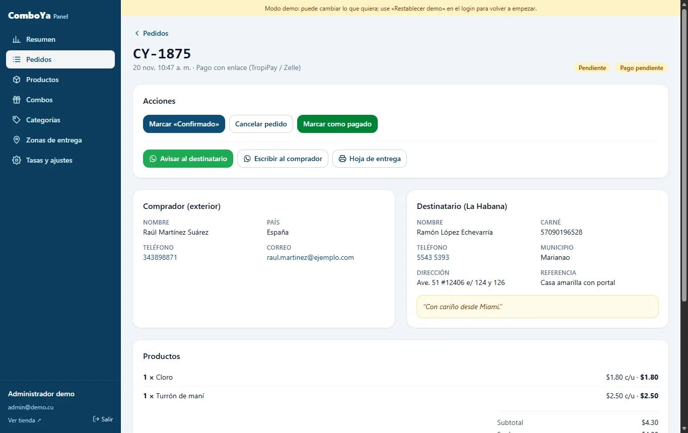
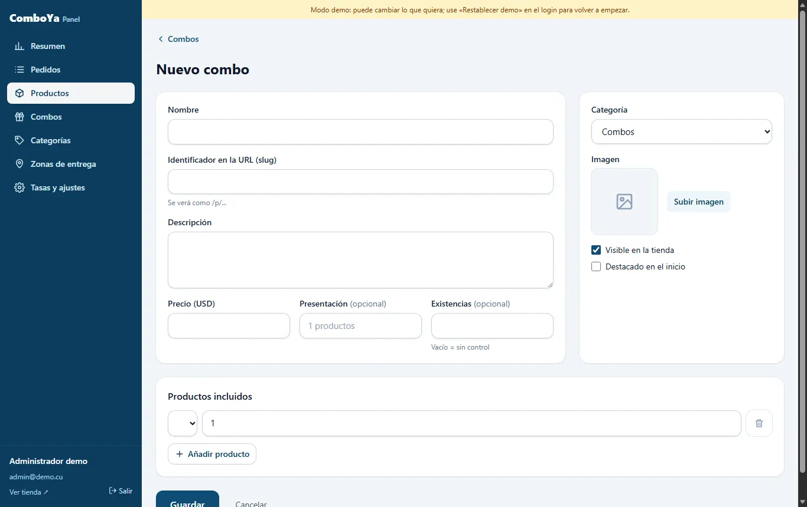

# ComboYa · Combos para su familia en La Habana

[](https://github.com/Tiza-Coderz/ComboYa/actions/workflows/ci.yml)

Tienda online para una mipyme cubana que vende **combos de comida, aseo y bebidas a cubanos en el exterior**, con entrega a sus familiares en La Habana. Incluye la tienda pública, el checkout en dos pasos, el seguimiento del pedido y un panel de administración completo.

> **Demo:** _(enlace de Vercel; se añade al publicar)_
> **Panel:** `/admin/login` · usuario **`admin@demo.cu`** · contraseña **`demo1234`**
> Puede cambiar lo que quiera: el botón **«Restablecer demo»** del login vuelve a los datos de ejemplo.

---

## El problema de negocio

Miles de cubanos en Miami, Madrid o Ciudad de México compran comida para su familia en Cuba. Hoy lo hacen por WhatsApp con listas de precios en imágenes, sin saber cuánto cuesta el envío y sin saber en qué estado está el pedido. Para la mipyme eso significa:

- horas respondiendo mensajes para cotizar el mismo combo una y otra vez;
- errores en direcciones, teléfonos y cobros, porque los datos llegan sueltos por chat;
- clientes ansiosos que escriben «¿ya llegó?» porque no tienen dónde ver el estado.

**ComboYa** pone el catálogo en línea con precios en USD (y su equivalente en CUP y EUR), calcula el envío por municipio, recoge los datos del comprador y del destinatario de forma ordenada y le da a cada pedido un código (**CY-1234**) para seguirlo. El negocio sigue trabajando por WhatsApp, pero con mensajes ya redactados y con toda la información en un panel.

## Funcionalidades

### Tienda pública

- **Inicio** con banners, categorías (Cárnicos, Granos, Aseo, Bebidas, Dulces, Combos), combos destacados y zonas de entrega.
- **Catálogo** con búsqueda de texto en español («frijol» encuentra «Frijoles negros», «arro» encuentra «Arroz»), filtros por categoría, tipo y precio máximo, orden y paginación. Funciona **sin JavaScript** (formularios GET).
- **Ficha de producto o combo**: el combo lista sus productos y muestra **cuánto se ahorra** frente a comprarlos por separado. Botones de WhatsApp para preguntar y para compartir.
- **Precios en USD** con selector **USD/EUR** y el equivalente aproximado en **CUP** según la tasa del día.
- **Carrito persistente** en `localStorage`, sincronizado entre pestañas. Al abrirlo se revalidan precios y disponibilidad con el servidor.
- **Checkout en 2 pasos**: 1) comprador (nombre, país, teléfono/WhatsApp, correo); 2) destinatario en Cuba (nombre, carné opcional, teléfono, municipio, dirección, referencia y mensaje para la familia). El envío y el total se calculan al momento.
- **Pago**: «Pago con enlace (TropiPay/Zelle — el negocio le contactará)» o «Efectivo al entregar (USD)». El estado del pago lo marca el negocio.
- **Al confirmar**: se crea el pedido con código corto, se abre **WhatsApp del negocio con el resumen** y se muestra **`/seguimiento/CY-1234`** con la línea de tiempo. Por privacidad, el seguimiento solo muestra el primer nombre de quien recibe.
- **SEO y Open Graph**: cada producto genera su propia imagen para compartir en WhatsApp/Facebook (nombre, precio en USD y CUP), además de JSON-LD de producto, sitemap y robots.
- **PWA instalable** con página sin conexión: las páginas visitadas se pueden ver sin red.

### Panel `/admin` (protegido)

- **Resumen**: ventas del periodo (7 o 30 días), ticket medio, monto por cobrar, pedidos pendientes, ventas por día, productos más vendidos y pedidos por municipio.
- **Pedidos**: tabla con filtros por estado, pago, municipio y búsqueda; detalle con datos completos, **cambio de estado** (solo transiciones válidas), **marcar pagado**, notas internas, notas visibles para el cliente, **avisar al destinatario por WhatsApp**, escribir al comprador e **imprimir la hoja de entrega** con casillas y firma.
- **Productos y combos**: CRUD con editor de productos incluidos y cálculo del ahorro, **subida de imágenes** (se comprimen a WebP en el navegador: una foto de 4 MB queda en unos 60 KB), visibilidad y destacado con un clic.
- **Categorías y zonas de entrega**: edición en línea (costo y días por municipio).
- **Tasas y ajustes**: tasa USD→CUP y USD→EUR con **historial** (fecha y autor), datos del negocio (WhatsApp, horario, correo) y «Restablecer demo».

## Capturas

| Inicio (móvil)                                         | Ficha de combo                                             | Checkout                                          |
| ------------------------------------------------------ | ---------------------------------------------------------- | ------------------------------------------------- |
|  |  |  |

| Tienda (escritorio)                                | Seguimiento                                                  |
| -------------------------------------------------- | ------------------------------------------------------------ |
|  |  |

| Panel: resumen                                      | Panel: pedidos                                  |
| --------------------------------------------------- | ----------------------------------------------- |
|  |  |

| Detalle del pedido                                     | Nuevo combo                                             |
| ------------------------------------------------------ | ------------------------------------------------------- |
|  |  |

## Stack

| Capa       | Tecnología                                                                                            |
| ---------- | ----------------------------------------------------------------------------------------------------- |
| Framework  | **Next.js 15** (App Router, Server Components, Server Actions, ISR)                                   |
| Lenguaje   | **TypeScript** estricto (`strict` + `noUncheckedIndexedAccess`)                                       |
| Estilos    | **Tailwind CSS v4**, fuentes del sistema, iconos SVG en línea                                         |
| Datos      | **Supabase**: Postgres con **RLS**, Auth para el admin, Storage para imágenes                         |
| Validación | **Zod** (los mismos esquemas en el navegador y en el servidor)                                        |
| Calidad    | ESLint, Prettier (+ orden de clases Tailwind), Vitest con cobertura, Husky + lint-staged + commitlint |
| CI         | GitHub Actions: formato → lint → tipos → tests con cobertura → build                                  |
| Despliegue | Vercel (Hobby) + Supabase (Free)                                                                      |

Sin librerías de UI, gráficos ni iconos: el JavaScript inicial de la tienda ronda los **145 kB** y los gráficos del panel son HTML/CSS.

## Arquitectura

```
src/
├─ domain/        CAPA 1 · Lógica pura, sin dependencias de framework (100 % testeada)
│                 dinero en centavos · totales y ahorro · códigos CY-1234 · máquina de estados
│                 teléfonos cubanos · carrito · mensajes de WhatsApp · métricas del dashboard · esquemas Zod
├─ server/        CAPA 2 · Servidor
│  ├─ supabase/     clientes: público con caché (ISR), con sesión (RLS) y service role (solo reset demo)
│  ├─ repositories/ acceso a datos y mapeo fila → modelo
│  ├─ services/     casos de uso (crear pedido y traducir errores de negocio)
│  ├─ actions/      Server Actions: validan con Zod y llaman a servicios/repositorios
│  └─ auth.ts       requireAdmin(): sesión + pertenencia a public.admins
├─ components/    CAPA 3 · UI reutilizable (ui/, tienda/, admin/)
└─ app/           Rutas: (tienda)/ pública · admin/ panel · OG, sitemap, manifest
supabase/migrations/   esquema, RLS, RPC y datos demo versionados en SQL
```

**Decisiones clave**

- **El servidor manda en los precios.** La tienda nunca escribe en `pedidos`: llama a la función `crear_pedido(jsonb)` (`SECURITY DEFINER`), que toma precios, envío y tasa de la base de datos, valida stock y zona, limita 5 pedidos por teléfono cada 10 minutos y guarda una **foto** de nombres, precios y tasa del momento. Si después se edita un producto, el histórico no cambia.
- **RLS en todas las tablas.** El público solo lee el catálogo activo; los pedidos solo los ve un admin. El seguimiento público usa la RPC `obtener_seguimiento(código)`, que no devuelve teléfonos, carné ni dirección.
- **Defensa en profundidad.** Las transiciones de estado se validan en el dominio (TypeScript) **y** en un trigger de Postgres: aunque alguien llame a la API directamente, no puede pasar un pedido de «pendiente» a «entregado».
- **Dinero en centavos enteros** en todo el dominio: nada de `0.1 + 0.2`.
- **Hecho para conexiones lentas.** Catálogo servido como estático desde la CDN (ISR, 60 s) con un cliente de Supabase sin cookies; imágenes WebP de ~6 KB; filtros sin JS; service worker con página sin conexión; si Supabase no responde, la tienda muestra un aviso en lugar de romperse.
- **Una sola fuente de verdad para la sesión.** Incluso la subida de imágenes pasa por una Server Action, así no hay dos clientes renovando el mismo token.

### Modelo de datos

```
categorias ─┐
            └─< productos (tipo: producto | combo) >─┬─< combo_items >─ productos
zonas_entrega ─┐                                     │
tasas_cambio   │ (histórico; la vigente es la última por moneda)
banners        │                                     │
configuracion  │ (fila única)                        │
               └─< pedidos ─┬─< pedido_items (foto de nombre y precio)
                            └─< pedido_eventos (línea de tiempo, se crean por trigger)
admins (user_id → auth.users)
```

## Cómo correrlo en local

Requisitos: **Node 22**, **pnpm 10** y un proyecto gratuito de [Supabase](https://supabase.com).

```bash
git clone https://github.com/Tiza-Coderz/ComboYa.git && cd ComboYa
pnpm install
cp .env.example .env.local      # complete las claves (ver abajo)
pnpm db:push                    # aplica supabase/migrations a su proyecto
pnpm seed                       # crea admin@demo.cu y siembra 48 productos, 15 zonas y 30 pedidos
pnpm dev                        # http://localhost:3000
```

Variables (`.env.local`):

| Variable                                                           | Dónde se obtiene                                                                                                   |
| ------------------------------------------------------------------ | ------------------------------------------------------------------------------------------------------------------ |
| `NEXT_PUBLIC_SUPABASE_URL`, `NEXT_PUBLIC_SUPABASE_ANON_KEY`        | Supabase → Project Settings → API                                                                                  |
| `SUPABASE_SERVICE_ROLE_KEY`                                        | Igual. **Solo servidor**, nunca con prefijo `NEXT_PUBLIC_`                                                         |
| `SUPABASE_DB_URL`                                                  | Supabase → Connect → **Session pooler**. Si la contraseña tiene `@`, `/` o `#`, codifíquelos (`%40`, `%2F`, `%23`) |
| `NEXT_PUBLIC_SITE_URL`                                             | URL pública (en Vercel se toma sola si se deja vacía)                                                              |
| `NEXT_PUBLIC_WHATSAPP_NEGOCIO`                                     | WhatsApp de respaldo, solo dígitos con código de país                                                              |
| `NEXT_PUBLIC_DEMO_MODE`, `DEMO_ADMIN_EMAIL`, `DEMO_ADMIN_PASSWORD` | Modo demo y credenciales del admin demo                                                                            |

Comandos útiles:

```bash
pnpm test            # tests del dominio (Vitest)
pnpm test:coverage   # con umbral de cobertura (90 % líneas y funciones)
pnpm lint && pnpm typecheck && pnpm format:check
pnpm build && pnpm start
pnpm imagenes        # regenera las imágenes WebP del catálogo demo
```

## Cómo desplegar GRATIS

**1. Base de datos — Supabase (plan Free)**

1. Cree un proyecto en [supabase.com](https://supabase.com). Elija la región más cercana a sus clientes (`us-east-1` para Miami y Cuba).
2. En su máquina, con `SUPABASE_DB_URL` en `.env.local`: `pnpm db:push && pnpm seed`.
3. En **Authentication → Providers → Email**, desactive «Enable sign ups»: el único usuario es el admin.

**2. Aplicación — Vercel (plan Hobby)**

1. En [vercel.com/new](https://vercel.com/new) importe el repositorio `Tiza-Coderz/ComboYa`. Vercel detecta Next.js y pnpm.
2. Añada las variables de entorno: `NEXT_PUBLIC_SUPABASE_URL`, `NEXT_PUBLIC_SUPABASE_ANON_KEY`, `SUPABASE_SERVICE_ROLE_KEY`, `NEXT_PUBLIC_WHATSAPP_NEGOCIO`, `NEXT_PUBLIC_DEMO_MODE=true`, `DEMO_ADMIN_EMAIL`, `DEMO_ADMIN_PASSWORD`. `NEXT_PUBLIC_SITE_URL` puede quedar vacía: se usa el dominio de producción de Vercel.
3. **Deploy.** Cada push a `main` despliega producción; cada PR recibe una URL de vista previa.
4. Pruebe: comparta un enlace `/p/combo-mega-mensual` en WhatsApp y verá la tarjeta con nombre y precio.

> El plan Free de Supabase pausa el proyecto tras 7 días sin actividad. Para una demo de portafolio basta con entrar de vez en cuando (o con un cron que haga una visita semanal).

## Flujo de trabajo

Git Flow con ramas `feature/*` integradas en `develop` mediante merge `--no-ff`, `release/x.y.z` hacia `main` con tag, y Conventional Commits en español validados por commitlint. Detalles en [CONTRIBUTING.md](./CONTRIBUTING.md).

---

## English summary

**ComboYa** is a production-style demo e-commerce store for a Cuban small business that sells food and household bundles ("combos") to Cubans abroad for delivery to their families in Havana. Built with **Next.js 15 (App Router, Server Actions, ISR), strict TypeScript, Tailwind v4 and Supabase** (Postgres with Row Level Security, Auth, Storage). It features a searchable catalog with USD/EUR prices and CUP equivalents from an admin-editable exchange rate, a persistent cart, a two-step checkout with per-municipality delivery fees, server-side price calculation in a `SECURITY DEFINER` Postgres function, short order codes with a public tracking page, WhatsApp deep links, per-product Open Graph images, and an installable PWA with offline support. The admin panel covers sales analytics, order management with a state machine enforced both in TypeScript and in a database trigger, printable delivery sheets, product/bundle CRUD with in-browser WebP image compression, delivery zones and exchange-rate history. The pure domain layer is fully unit-tested, and CI runs format, lint, type-check, tests with coverage thresholds and a production build. Demo login: `admin@demo.cu` / `demo1234`.
